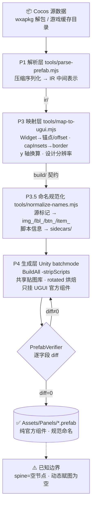

# Cocos2UGUI

把 **Cocos Creator 3.x 小游戏 UI 预制体** 结构化转换为 **Unity UGUI 预制体** 的开源流水线：解析 → 映射 → 命名规范化 → 生成 → 机器验证，全程幂等、可批量、零人工数学换算。

> 由逆向一个 Cocos Creator 3.8.8 微信小游戏的实践中提炼而来，与任何特定游戏解耦。仅供学习研究。

## 全景流程



## 特性

- **零依赖 Node 解析器**：完整反序列化 Cocos Creator 3.x 压缩序列化格式（类型表/字符串池/Refs 槽位），嵌套 prefab 展开、资产引用 100% 落地
- **数学全部前置到映射层**：`build.json` 契约里的 rect 六元组（anchorMin/Max/offsetMin/Max/pivot/anchoredPosition+sizeDelta）是换算完成的最终 UGUI 语义值，Unity 侧只赋值不做数学
- **命名规范化**：剥 Cocos 源命名标记（`_spr:/_lab:/_btn:/_arr:` 等）映射为 `img_/lbl_/btn_/item_` 前缀体系，幂等可重放，原名自动备份
- **纯官方组件输出**：`-stripScripts` 模式下 prefab 只含 Image/Text/Button/Layout/RectMask2D/CanvasGroup/ScrollRect 等官方组件，自定义逻辑脚本信息导出为 sidecar JSON 不丢失
- **工程级细节**：图集 rotated 切图像素级烘焙还原（rect=原始朝向、物理块转置的实证规则）、共享贴图库去重、九宫格 border、ScrollRect/Layout 完整接线、逐字段 diff 验证器

## 快速开始

环境：Node.js ≥ 18、Unity 2022.3 LTS（含 UGUI）。

```bash
# 0) (可选) 微信小游戏 wxapkg 解包 → 得到 gamecaches 缓存目录
node tools/unpack-wxapkg.mjs <wxapkg 目录或 .wxapkg> --appid wxXXXXXXXXXXXXXXXX

# 1) 批量解析 + 映射（--gamecaches 指向缓存根目录）
node tools/batch-all.mjs --gamecaches "<...>/usr/gamecaches"
#    产物: ir/*.json (IR) + build/*.build.json (UGUI 契约)

# 2) 命名规范化（幂等; 原名备份 build-raw/; 脚本信息落 sidecars/）
node tools/normalize-names.mjs

# 3) Unity 构建（用 unity/ 下的脚本接入你的工程后）
Unity.exe -batchmode -quit -projectPath <工程> \
  -executeMethod Cocos2UguiBuilder.BuildAll -stripScripts \
  -buildDir <仓库>/build

# 4) 机器验证（逐字段 diff, exit 0 = 全绿）
Unity.exe -batchmode -quit -projectPath <工程> \
  -executeMethod PrefabVerifier.VerifyAll -stripScripts -buildDir <仓库>/build
```

最小端到端样例（合成数据，无需任何游戏资产）已内置：`unity/Assets/StreamingAssets/builds/sample-min.build.json`。

## 目录结构

```
├── tools/                  # Node 工具链（零第三方依赖）
│   ├── unpack-wxapkg.mjs   #   wxapkg 解密+解包（PBKDF2/AES/XOR, 密钥=AppID）
│   ├── parse-prefab.mjs    #   压缩序列化 → IR
│   ├── batch-all.mjs       #   批量驱动（枚举全部 cc.Prefab）
│   ├── map-to-ugui.mjs     #   IR → build.json（UGUI 契约）
│   ├── normalize-names.mjs #   命名规范化（P3.5）
│   ├── validate-build.mjs  #   build.json 契约校验
│   └── verify-ir.mjs       #   IR 结构自检
├── docs/
│   ├── IR-SCHEMA.md        #   IR 中间表示格式
│   ├── BUILD-SCHEMA.md     #   P3→P4 契约（UGUI 语义值）
│   ├── MAPPING-RULES.md    #   Cocos→UGUI 逐规则实证（Widget 位表/y轴/capInsets…）
│   ├── NAMING-SPEC.md      #   命名规范与源标记映射表
│   └── PIPELINE-FLOW.md    #   流水线全景图
├── tests/map-tests/        # golden 单测（synthetic 基线内置; 面板级回归需自备数据）
└── unity/                  # Unity 侧接入（Editor 脚本 + 合成样例）
```

## Unity 侧

详见 [unity/README.md](unity/README.md)。核心三入口：`Cocos2UguiBuilder.BuildAll`（构建）/ `PrefabVerifier.VerifyAll`（逐字段 diff）/ `PanelCapture.CaptureAll`（截图）。将 `unity/Assets/Editor/*.cs` 与 `Assets/Scripts/CocosMarker.cs` 拷入你的工程即可。

## 测试

```bash
cd tests/map-tests && node run-all.mjs
```

- 无本地数据：自动跑 synthetic 基线（fixture 驱动的全规则覆盖）
- 放入你自己的 `ir/*.json` 后：自动启用面板级 golden 回归（t1-t9 全量）

## 已知边界

| 项 | 状态 |
|----|------|
| sp.Skeleton（spine） | 输出空节点占位（需 spine-unity，本工具不接） |
| cc.Graphics | 无 UGUI 等价组件，Marker 记录 |
| 运行时动态赋图/动态文本 | 静态数据本无值，prefab 中为空，属复刻天然边界 |
| rotated 裁边帧 | 内容正确，透明边不回填（轻微拉伸） |

## 免责声明

本项目仅用于**个人学习、研究与互操作性目的**。任何通过本工具处理的游戏资源，其著作权归原权利方所有；请勿将输出物用于商业发布或任何侵权用途。使用本工具产生的合规与法律责任由使用者自行承担。

## License

[MIT](LICENSE)
