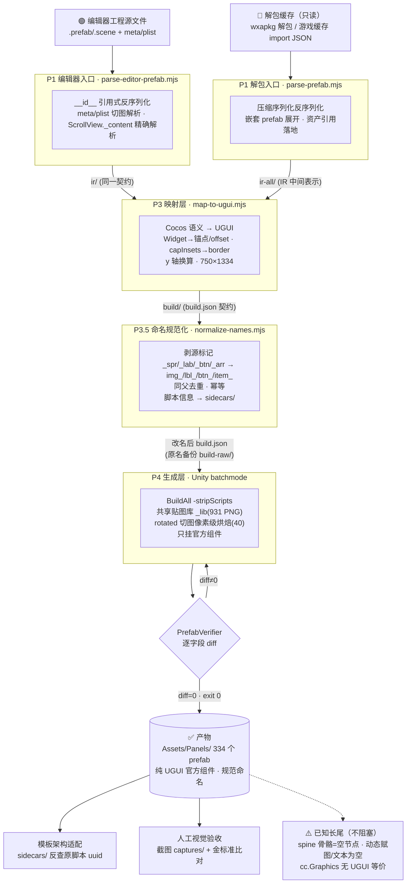

# Cocos → UGUI 转换流水线（全景）

## 机器耗时（全量重跑 ≈ 5 分钟，全链路幂等）

| 步骤 | 命令 | 耗时 |
|------|------|------|
| P1+P3（编辑器工程） | `node batch-all.mjs --editor <工程根>` | 按规模 |
| P1+P3（解包缓存） | `node batch-all.mjs --gamecaches <dir>` | 98 s |
| P3.5 | `node normalize-names.mjs` | < 5 s |
| P4 构建 | `Unity -executeMethod Cocos2UguiBuilder.BuildAll -stripScripts` | ~60 s |
| P4 验证 | `Unity -executeMethod PrefabVerifier.VerifyAll -stripScripts` | ~30 s |

规范文档：[UI-NAMING-SPEC.md](UI-NAMING-SPEC.md) · 契约：[BUILD-SCHEMA.md](BUILD-SCHEMA.md)
